# BAB III: METODOLOGI PENELITIAN DAN PERANCANGAN SISTEM

Dokumen ini disusun sebagai materi acuan dan draf siap pakai untuk penulisan **BAB III Skripsi** pada sistem:  
**SISPEJUR (Sistem Rekomendasi Jurusan Kuliah Berbasis Web Menggunakan Algoritma Random Forest pada MA Plus Peradaban Insani)**.

---

## 3.1 Analisis Sistem

### 3.1.1 Analisis Sistem Berjalan
Pada MA Plus Peradaban Insani, proses penentuan dan pemilihan jurusan perguruan tinggi bagi siswa kelas XII saat ini masih dilakukan melalui mekanisme bimbingan konvensional yang memiliki beberapa kelemahan:

1. **Alur Konsultasi Manual:** Konsultasi minat dan bakat hanya dilakukan secara tatap muka dengan Guru Bimbingan Konseling (BK) dalam alokasi waktu yang sangat terbatas.
2. **Subjektivitas Tinggi:** Rekomendasi jurusan cenderung didasarkan pada perkiraan kasual dan intuisi tanpa pembobotan berbasis probabilitas empiris dari histori kelulusan siswa terdahulu (alumni).
3. **Penyimpanan Data Terfragmentasi:** Nilai rapor siswa tersimpan di buku leger/spreadsheet terpisah, sedangkan data minat siswa tidak terarsipkan secara terstruktur dalam basis data digital.
4. **Keterbatasan Evaluasi:** Tidak ada pengukuran tingkat akurasi atau evaluasi metrik matematis terhadap kesesuaian antara kemampuan akademik siswa dengan jurusan yang dituju.

| Aspek | Sistem Berjalan | Masalah / Kendala |
|---|---|---|
| **Instrumen Minat** | Kuesioner cetak / Wawancara lisan | Rawan hilang, memakan waktu rekapitulasi, skala tidak seragam. |
| **Data Akademik** | Buku rapor / spreadsheet manual | Tidak terintegrasi secara otomatis dengan profil minat siswa. |
| **Metode Penentuan** | Pertimbangan subjektif & intuisi | Kurang objektif, rentan bias personal, tidak ada persentase kecocokan. |
| **Keluaran (Output)**| Rekomendasi 1 jurusan lisan | Siswa tidak memiliki opsi alternatif (Top-N) terukur jika jurusan utama tidak lolos. |

### 3.1.2 Analisis Sistem Usulan
Sistem yang diusulkan adalah **SISPEJUR**, sebuah aplikasi web berbasis framework **Python Django** yang memanfaatkan algoritma machine learning **Random Forest Classifier** (`Scikit-Learn`) untuk merekomendasikan jurusan kuliah.

Sistem usulan memberikan solusi komprehensif:
1. **Digitalisasi Pengumpulan Data:** Siswa mengakses sistem menggunakan Nomor Induk Siswa (NIS) untuk mengisi instrumen kuesioner minat dan bakat (18 butir pertanyaan skala Likert 1–5).
2. **Integrasi Data Akademik:** Admin mengelola nilai rapor siswa untuk 6 mata pelajaran utama (Matematika, Bahasa Indonesia, Bahasa Inggris, IPA, IPS, dan Agama Islam).
3. **Prediksi Berbasis Machine Learning:** Sistem menerapkan model Random Forest yang dilatih dari data historis alumni (120 data latih seimbang pada 10 jurusan target).
4. **Peringkat Top 5 Rekomendasi (Soft Voting):** Menghasilkan 5 jurusan alternatif teratas berdasarkan ranking distribusi probabilitas model (`predict_proba`), sehingga siswa memiliki pilihan realistis dan alternatif cadangan.
5. **Transparansi Perhitungan:** Admin dapat memantau 5 tahapan kalkulasi inferensi (Data Input, Preprocessing, Informasi Model, Distribusi Probabilitas/Ensemble Voting, dan Ranking).

---

## 3.2 Perhitungan Algoritma Random Forest

### 3.2.1 Persiapan Data
Dataset yang digunakan dalam sistem mencakup data historis alumni MA Plus Peradaban Insani sebanyak 120 record yang terdistribusi secara seimbang (*balanced dataset*) ke dalam 10 jurusan target (12 record per jurusan):

1. **Teknik Informatika**
2. **Sistem Informasi**
3. **Kedokteran**
4. **Farmasi**
5. **Manajemen Bisnis**
6. **Akuntansi**
7. **Ilmu Hukum**
8. **Psikologi**
9. **Pendidikan Agama Islam**
10. **Desain Komunikasi Visual (DKV)**

### 3.2.2 Penentuan Atribut dan Label
Model inferensi menggunakan **12 Fitur Numerik** ($X$) dan **1 Label Target Kategorikal** ($Y$):

#### A. Fitur Input ($X_1$ s/d $X_{12}$)
1. **Fitur Akademik (Skala Kontinu 0.0 - 100.0):**
   - $X_1$: `nilai_matematika` — Nilai rapor Matematika.
   - $X_2$: `nilai_bahasa_indonesia` — Nilai rapor Bahasa Indonesia.
   - $X_3$: `nilai_bahasa_inggris` — Nilai rapor Bahasa Inggris.
   - $X_4$: `nilai_ipa` — Nilai rumpun IPA (Fisika / Biologi / Kimia).
   - $X_5$: `nilai_ips` — Nilai rumpun IPS (Ekonomi / Geografi / Sosiologi).
   - $X_6$: `nilai_agama` — Nilai Pendidikan Agama Islam.
2. **Fitur Minat & Bakat (Skala Rata-Rata Likert 1.0 - 5.0):**
   - $X_7$: `minat_teknologi` — Rata-rata respons Q01, Q02, Q03 (logika algoritma, hardware/jaringan, AI & data).
   - $X_8$: `minat_sains` — Rata-rata respons Q04, Q05, Q06 (anatomi medis, kimia/farmasi, investigasi sains murni).
   - $X_9$: `minat_bisnis` — Rata-rata respons Q07, Q08, Q09 (kewirausahaan, akuntansi/keuangan, pasar modal).
   - $X_{10}$: `minat_sosial` — Rata-rata respons Q10, Q11, Q12 (hukum/advokasi, psikologi, isu sosial).
   - $X_{11}$: `minat_seni` — Rata-rata respons Q13, Q14, Q15 (desain visual, multimedia, sastra/bahasa).
   - $X_{12}$: `minat_pendidikan` — Rata-rata respons Q16, Q17, Q18 (pengajaran agama, pedagogi, kurikulum).

#### B. Label Target ($Y$)
Variabel target $Y \in \{C_1, C_2, \dots, C_{10}\}$ yang merepresentasikan 10 jurusan perguruan tinggi.

### 3.2.3 Pembagian Data Training dan Testing
Data latih dibagi menggunakan teknik *Train-Test Split*:
- **Rasio Pembagian:** 80% Data Latih (96 sampel) dan 20% Data Uji (24 sampel).
- **Random State:** 42 (untuk memastikan hasil eksperimen bersifat *reproducible*).
- **Stratifikasi:** Pembagian dilakukan dengan proporsi kelas target yang merata pada data latih dan data uji.

### 3.2.4 Pembentukan Pohon Keputusan (Decision Tree Ensemble)
Algoritma Random Forest membentuk sekumpulan pohon keputusan ($B$ *trees*, di mana default $B = 100$) melalui dua tahapan utama:

#### 1. Bootstrap Aggregating (Bagging)
Untuk setiap pohon $b \in \{1, 2, \dots, B\}$, diambil sampel data sebanyak $N$ record dari dataset pelatihan secara acak dengan pengembalian (*random sampling with replacement*). Data yang tidak terpilih disebut *Out-of-Bag (OOB)* data.

#### 2. Random Feature Selection
Pada setiap percabangan node pohon, sistem tidak mengevaluasi seluruh 12 fitur, melainkan memilih subset fitur secara acak sejumlah $m$:
$$m = \sqrt{p} = \sqrt{12} \approx 3.46 \rightarrow 3 \text{ atau } 4 \text{ fitur acak}$$

#### 3. Kriteria Pemilihan Split Node (Gini Impurity)
Pemisahan node terbaik ditentukan dengan meminimalkan nilai *Gini Impurity*:
$$Gini(D) = 1 - \sum_{i=1}^{C} p_i^2$$
Di mana $p_i$ adalah proporsi sampel kelas ke-$i$ pada node $D$, dan $C = 10$ adalah jumlah kelas jurusan.

Penurunan ketidakmurnian (*Gini Gain*) dihitung dengan:
$$\Delta Gini = Gini(D) - \left( \frac{|D_L|}{|D|} Gini(D_L) + \frac{|D_R|}{|D|} Gini(D_R) \right)$$
Node dipisahkan berdasarkan fitur dan batas nilai ambang (*threshold*) yang menghasilkan $\Delta Gini$ maksimum.

### 3.2.5 Proses Voting dan Penentuan Hasil Prediksi
Pada saat pengujian data baru $X^* = [x_1, x_2, \dots, x_{12}]$:
1. Setiap pohon keputusan ke-$b$ menghasilkan estimasi probabilitas kelas $\hat{P}_b(y = c | X^*)$.
2. Random Forest melakukan agregasi secara *Soft Voting* (rata-rata probabilitas dari seluruh pohon):
   $$P(y = c | X^*) = \frac{1}{B} \sum_{b=1}^{B} \hat{P}_b(y = c | X^*)$$
3. Seluruh probabilitas kelas diurutkan secara menurun (*descending*):
   $$\text{Rank}(C) = \text{sort\_descending}(\{P(y = c | X^*) \mid c \in \text{Classes}\})$$
4. **Top 5 Rekomendasi:** Lima jurusan dengan probabilitas tertinggi dipilih sebagai luaran rekomendasi, dengan peringkat pertama (Rank 1) ditetapkan sebagai **Rekomendasi Utama**.

### 3.2.6 Evaluasi Model
Model dievaluasi menggunakan data uji (24 sampel *unseen test data*) dengan metrik:

1. **Akurasi (Accuracy):**
   $$\text{Accuracy} = \frac{TP + TN}{TP + TN + FP + FN}$$
2. **Presisi (Precision - Macro & Weighted Average):**
   $$\text{Precision}_c = \frac{TP_c}{TP_c + FP_c}, \quad \text{Precision}_{\text{macro}} = \frac{1}{C}\sum_{c=1}^C \text{Precision}_c$$
3. **Recall (Recall - Macro & Weighted Average):**
   $$\text{Recall}_c = \frac{TP_c}{TP_c + FN_c}, \quad \text{Recall}_{\text{macro}} = \frac{1}{C}\sum_{c=1}^C \text{Recall}_c$$
4. **F1-Score:**
   $$\text{F1-Score} = 2 \times \frac{\text{Precision} \times \text{Recall}}{\text{Precision} + \text{Recall}}$$
5. **Confusion Matrix:** Matriks kontingensi berukuran $10 \times 10$ untuk memetakan prediksi benar (*True Positive*) dan kesalahan klasifikasi (*Misclassification*) antarkelas jurusan.
6. **Feature Importance (Mean Decrease in Impurity / MDI):** Menghitung kontribusi relatif setiap fitur dalam menurunkan Gini Impurity pada seluruh pohon.

### 3.2.7 Diagram Alir (Flowchart) Perancangan, Pelatihan, dan Pengujian Model

Perancangan model Random Forest pada sistem SISPEJUR terbagi menjadi dua siklus utama: **(1) Siklus Pelatihan dan Evaluasi Model (*Training & Evaluation Phase*)**, dan **(2) Siklus Pengujian / Inferensi Prediksi Siswa (*Testing & Inference Phase*)**.

#### A. Diagram Arsitektur Ensemble Random Forest
Diagram berikut menggambarkan bagaimana data input diproses secara ensemble oleh sekumpulan pohon keputusan independen yang dibentuk melalui mekanisme *Bagging* dan *Random Feature Selection*, kemudian digabungkan melalui *Soft Voting* untuk menghasilkan probabilitas 10 jurusan.

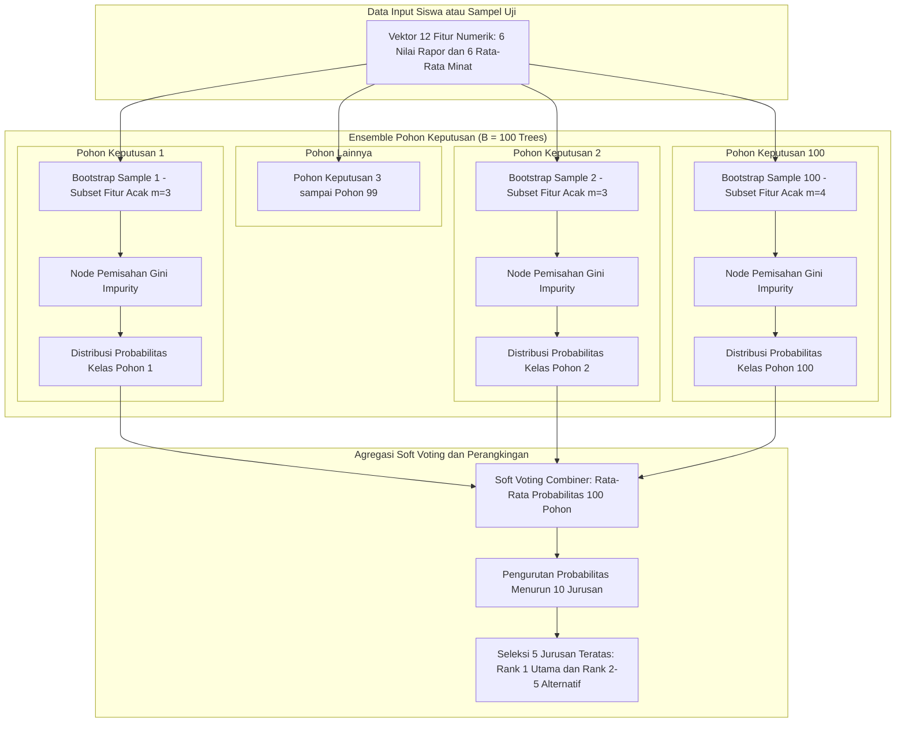

---

#### B. Diagram Alir Pelatihan dan Evaluasi Model (Training Phase)
Diagram alir ini menggambarkan alur kerja sistem saat Admin menjalankan proses pelatihan model dari menu Data Latih:

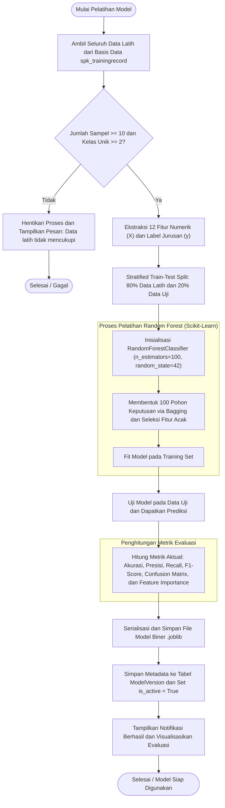

---

#### C. Diagram Alir Pengujian / Inferensi Rekomendasi Siswa (Testing & Inference Phase)
Diagram alir ini menggambarkan bagaimana data siswa baru diuji dan diproses menggunakan model Random Forest yang telah aktif untuk menghasilkan 5 rekomendasi jurusan:

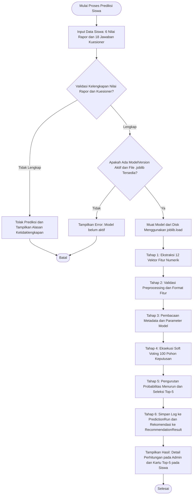

---

## 3.3 Perancangan Basis Data

### 3.3.1 Identifikasi Entitas
Sistem SISPEJUR memiliki entitas data utama:
1. **User (Admin):** Entitas pengelola sistem (otentikasi Django Auth).
2. **Student:** Entitas siswa MA Plus Peradaban Insani.
3. **StudentAcademicData:** Entitas nilai rapor akademik 6 mata pelajaran.
4. **InterestQuestion:** Entitas butir instrumen pertanyaan minat dan bakat.
5. **StudentInterestResponse:** Entitas jawaban siswa terhadap butir instrumen minat.
6. **TrainingRecord:** Entitas dataset latih historis alumni berlabel jurusan.
7. **ModelVersion:** Entitas metadata dan artifak model Random Forest yang dilatih.
8. **PredictionRun:** Entitas eksekusi kalkulasi prediksi jurusan per siswa.
9. **RecommendationResult:** Entitas luaran 5 jurusan rekomendasi hasil prediksi.

### 3.3.2 Entity Relationship Diagram (ERD)

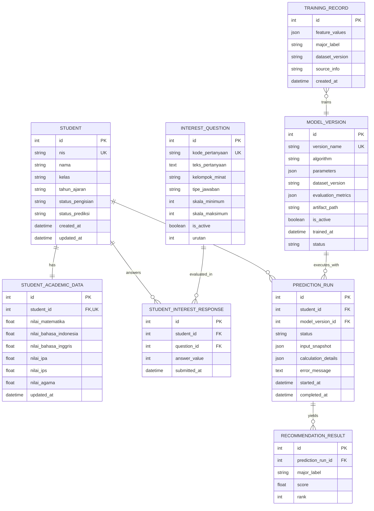

### 3.3.3 Relasi Antartabel
1. **Student ke StudentAcademicData (One-to-One):** Satu siswa hanya memiliki tepat satu rekam nilai akademik rapor.
2. **Student ke StudentInterestResponse (One-to-Many):** Satu siswa memberikan banyak jawaban untuk instrumen pertanyaan minat.
3. **InterestQuestion ke StudentInterestResponse (One-to-Many):** Satu pertanyaan minat dijawab oleh banyak siswa.
4. **Student ke PredictionRun (One-to-Many):** Satu siswa dapat memiliki riwayat beberapa kali eksekusi prediksi.
5. **ModelVersion ke PredictionRun (One-to-Many):** Satu versi model machine learning dapat digunakan untuk mengeksekusi banyak sesi prediksi siswa.
6. **PredictionRun ke RecommendationResult (One-to-Many):** Satu kali sesi prediksi menghasilkan 5 record luaran peringkat jurusan.

### 3.3.4 Struktur Tabel (Kamus Data)

#### 1. Tabel `spk_student` (Data Siswa)
| Nama Kolom | Tipe Data | Nullable | Keterangan |
|---|---|---|---|
| `id` | INTEGER | No (PK, Auto) | ID unik data siswa |
| `nis` | VARCHAR(20) | No (Unique) | Nomor Induk Siswa |
| `nama` | VARCHAR(150) | No | Nama lengkap siswa |
| `kelas` | VARCHAR(50) | No | Rombongan belajar (cth: "XII IPA 1") |
| `tahun_ajaran` | VARCHAR(20) | No | Tahun akademik (cth: "2024/2025") |
| `status_pengisian` | VARCHAR(30) | No | Enum: 'Belum mengisi', 'Sudah mengisi', 'Perlu melengkapi data' |
| `status_prediksi` | VARCHAR(30) | No | Enum: 'Menunggu', 'Diproses', 'Berhasil', 'Gagal', 'Perlu prediksi ulang' |
| `created_at` | DATETIME | No | Waktu pembuatan data |
| `updated_at` | DATETIME | No | Waktu modifikasi terakhir |

#### 2. Tabel `spk_studentacademicdata` (Nilai Akademik Rapor)
| Nama Kolom | Tipe Data | Nullable | Keterangan |
|---|---|---|---|
| `id` | INTEGER | No (PK, Auto) | ID unik rekam nilai |
| `student_id` | INTEGER | No (FK, Unique) | Relasi ke `spk_student.id` |
| `nilai_matematika` | FLOAT | No | Nilai rapor Matematika (0.0 - 100.0) |
| `nilai_bahasa_indonesia` | FLOAT | No | Nilai rapor Bahasa Indonesia (0.0 - 100.0) |
| `nilai_bahasa_inggris` | FLOAT | No | Nilai rapor Bahasa Inggris (0.0 - 100.0) |
| `nilai_ipa` | FLOAT | No | Nilai Fisika/Kimia/Biologi (0.0 - 100.0) |
| `nilai_ips` | FLOAT | No | Nilai Ekonomi/Geografi/Sosiologi (0.0 - 100.0) |
| `nilai_agama` | FLOAT | No | Nilai PAI (0.0 - 100.0) |
| `updated_at` | DATETIME | No | Waktu pembaruan nilai |

#### 3. Tabel `spk_interestquestion` (Instrumen Pertanyaan Minat)
| Nama Kolom | Tipe Data | Nullable | Keterangan |
|---|---|---|---|
| `id` | INTEGER | No (PK, Auto) | ID butir pertanyaan |
| `kode_pertanyaan` | VARCHAR(20) | No (Unique) | Kode instrumen (Q01 s/d Q18) |
| `teks_pertanyaan` | TEXT | No | Deskripsi pernyataan instrumen |
| `kelompok_minat` | VARCHAR(50) | No | Kategori kelompok minat (6 kelompok) |
| `tipe_jawaban` | VARCHAR(30) | No | Tipe input ('skala_likert') |
| `skala_minimum` | INTEGER | No | Nilai minimal skala (1) |
| `skala_maksimum` | INTEGER | No | Nilai maksimal skala (5) |
| `is_active` | BOOLEAN | No | Status aktif pertanyaan |
| `urutan` | INTEGER | No | Nomor urut penampilan pada formulir |

#### 4. Tabel `spk_studentinterestresponse` (Jawaban Kuesioner Siswa)
| Nama Kolom | Tipe Data | Nullable | Keterangan |
|---|---|---|---|
| `id` | INTEGER | No (PK, Auto) | ID jawaban kuesioner |
| `student_id` | INTEGER | No (FK) | Relasi ke `spk_student.id` |
| `question_id` | INTEGER | No (FK) | Relasi ke `spk_interestquestion.id` |
| `answer_value` | INTEGER | No | Pilihan jawaban skala Likert (1 - 5) |
| `submitted_at` | DATETIME | No | Waktu submit jawaban |

#### 5. Tabel `spk_trainingrecord` (Dataset Pelatihan)
| Nama Kolom | Tipe Data | Nullable | Keterangan |
|---|---|---|---|
| `id` | INTEGER | No (PK, Auto) | ID baris dataset latih |
| `feature_values` | JSON | No | Nilai 12 fitur vektor pelatihan |
| `major_label` | VARCHAR(100) | No | Label jurusan target alumni |
| `dataset_version` | VARCHAR(50) | No | Versi dataset (cth: 'v1.0') |
| `source_info` | VARCHAR(150) | No | Asal data (cth: 'Alumni MA Plus...') |
| `created_at` | DATETIME | No | Waktu pencatatan data latih |

#### 6. Tabel `spk_modelversion` (Versi Model Machine Learning)
| Nama Kolom | Tipe Data | Nullable | Keterangan |
|---|---|---|---|
| `id` | INTEGER | No (PK, Auto) | ID model tersimpan |
| `version_name` | VARCHAR(50) | No (Unique) | Kode model (cth: 'RF-20261019_184400') |
| `algorithm` | VARCHAR(100) | No | Nama algoritma ('Random Forest Classifier') |
| `parameters` | JSON | No | Hyperparameter (n_estimators, max_depth, dll) |
| `dataset_version` | VARCHAR(50) | No | Versi dataset saat pelatihan |
| `evaluation_metrics` | JSON | No | Akurasi, F1, Precision, Recall, CM, Importances |
| `artifact_path` | VARCHAR(255) | No | Lokasi file biner serialisasi (`.joblib`) |
| `is_active` | BOOLEAN | No | Status model aktif untuk inferensi |
| `trained_at` | DATETIME | No | Waktu pelatihan model selesai |
| `status` | VARCHAR(30) | No | Status operasional ('active' / 'inactive') |

#### 7. Tabel `spk_predictionrun` (Riwayat Sesi Prediksi)
| Nama Kolom | Tipe Data | Nullable | Keterangan |
|---|---|---|---|
| `id` | INTEGER | No (PK, Auto) | ID sesi eksekusi prediksi |
| `student_id` | INTEGER | No (FK) | Relasi ke siswa yang diprediksi |
| `model_version_id` | INTEGER | Yes (FK) | Relasi ke model yang digunakan |
| `status` | VARCHAR(30) | No | 'Menunggu', 'Diproses', 'Berhasil', 'Gagal' |
| `input_snapshot` | JSON | No | Salinan nilai 12 fitur saat prediksi dieksekusi |
| `calculation_details`| JSON | No | Detail log komputasi 5 tahap transparan |
| `error_message` | TEXT | Yes | Catatan pesan kesalahan jika prediksi gagal |
| `started_at` | DATETIME | No | Waktu awal proses inferensi |
| `completed_at` | DATETIME | No | Waktu penyelesaian kalkulasi |

#### 8. Tabel `spk_recommendationresult` (Hasil Rekomendasi Jurusan)
| Nama Kolom | Tipe Data | Nullable | Keterangan |
|---|---|---|---|
| `id` | INTEGER | No (PK, Auto) | ID hasil rekomendasi |
| `prediction_run_id` | INTEGER | No (FK) | Relasi ke sesi `spk_predictionrun.id` |
| `major_label` | VARCHAR(100) | No | Nama jurusan perguruan tinggi |
| `score` | FLOAT | No | Skor probabilitas hasil soft-voting (%) |
| `rank` | INTEGER | No | Urutan peringkat jurusan (1 s/d 5) |

---

## 3.4 Perancangan UML (Unified Modeling Language)

Untuk menjaga konsistensi perancangan berorientasi objek (*Object-Oriented Analysis and Design*), perancangan UML disusun dengan kaidah akademis: **1 Use Case = 1 Skenario Use Case = 1 Activity Diagram = 1 Sequence Diagram**. Sistem SISPEJUR memodelkan **7 Use Case Fungsional Utama** yang mencakup seluruh alur bisnis sistem bagi dua aktor: **Siswa** dan **Admin**.

### 3.4.1 Use Case Diagram dan Spesifikasi Skenario

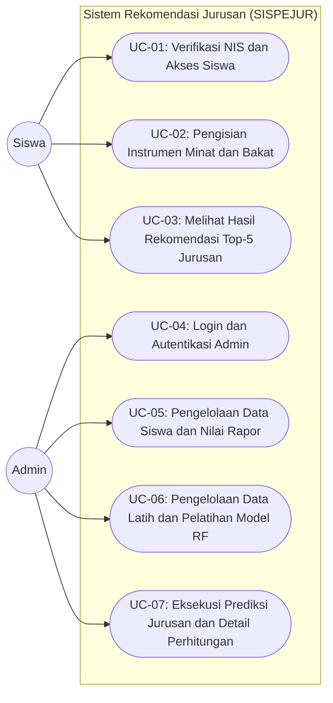

#### Tabel Spesifikasi Skenario Use Case

##### 1. UC-01: Verifikasi NIS dan Akses Siswa
* **Aktor:** Siswa
* **Deskripsi:** Siswa memasukkan NIS pada halaman awal untuk mengautentikasi identitas diri tanpa kata sandi rumit.
* **Kondisi Awal:** Siswa membuka antarmuka utama sistem (`/`).
* **Alur Utama:**
  1. Siswa menginput NIS ke dalam form.
  2. Sistem mencari record siswa pada tabel `spk_student`.
  3. Sistem memvalidasi status pengisian dan status prediksi siswa.
  4. Sistem mengarahkan siswa ke halaman formulir (jika belum mengisi) atau halaman status/hasil (jika sudah mengisi).
* **Kondisi Akhir:** Siswa berhasil masuk ke sesi sistem sesuai status profilnya.

##### 2. UC-02: Pengisian Instrumen Minat dan Bakat
* **Aktor:** Siswa
* **Deskripsi:** Siswa menjawab 18 butir pertanyaan kuesioner minat dan bakat berskala Likert (1–5).
* **Kondisi Awal:** Siswa telah terverifikasi pada UC-01 dan berstatus 'Belum mengisi'.
* **Alur Utama:**
  1. Sistem menampilkan 18 butir pertanyaan yang dikelompokkan ke dalam 6 kategori minat.
  2. Siswa memilih opsi jawaban skala 1 (Sangat Tidak Minat) hingga 5 (Sangat Berminat).
  3. Siswa menekan tombol kirim respons kuesioner.
  4. Sistem menyimpan jawaban ke entitas `StudentInterestResponse` dan mengubah status pengisian siswa menjadi 'Sudah mengisi'.
  5. Sistem mengarahkan siswa ke halaman status menunggu prediksi.
* **Kondisi Akhir:** Jawaban tersimpan di basis data dan siswa berada pada status menunggu proses kalkulasi admin.

##### 3. UC-03: Melihat Hasil Rekomendasi Top-5 Jurusan
* **Aktor:** Siswa
* **Deskripsi:** Siswa mengakses laporan hasil rekomendasi 5 jurusan teratas beserta persentase probabilitas kecocokan.
* **Kondisi Awal:** Prediksi siswa telah berhasil dieksekusi oleh Admin (status prediksi = 'Berhasil').
* **Alur Utama:**
  1. Siswa membuka menu hasil rekomendasi (`/hasil-rekomendasi/`).
  2. Sistem mengambil data luaran dari tabel `spk_recommendationresult` berdasarkan sesi prediksi terakhir.
  3. Sistem menyajikan kartu Rekomendasi Utama (Rank 1) dan tabel daftar 5 jurusan dengan progress bar persentase skor.
  4. Siswa membaca saran rekomendasi dan catatan edukatif yang disajikan.
* **Kondisi Akhir:** Siswa memperoleh informasi rekomendasi jurusan kuliah secara transparan.

##### 4. UC-04: Login dan Autentikasi Admin
* **Aktor:** Admin
* **Deskripsi:** Admin masuk ke sistem menggunakan username dan password terenkripsi.
* **Kondisi Awal:** Admin membuka halaman login pengelola (`/admin-spk/login/`).
* **Alur Utama:**
  1. Admin menginput username dan password.
  2. Sistem memvalidasi kredensial ke modul Django Auth.
  3. Sistem membuat sesi aktif dan mengarahkan Admin ke halaman Dashboard.
* **Kondisi Akhir:** Admin memiliki hak akses penuh terhadap seluruh fitur manajemen sistem.

##### 5. UC-05: Pengelolaan Data Siswa dan Nilai Rapor
* **Aktor:** Admin
* **Deskripsi:** Admin melakukan penambahan, pembaruan, penghapusan data siswa serta menginput 6 nilai rapor akademik.
* **Kondisi Awal:** Admin berada pada Dashboard dan memilih menu 'Data Siswa'.
* **Alur Utama:**
  1. Admin membuka daftar data siswa.
  2. Admin memilih tambah data baru atau edit siswa terpilih.
  3. Admin memasukkan identitas (NIS, nama, kelas) dan 6 nilai rapor (Matematika, B. Indo, B. Inggris, IPA, IPS, Agama).
  4. Sistem memvalidasi rentang nilai (0–100) dan menyimpan ke tabel `spk_student` dan `spk_studentacademicdata`.
* **Kondisi Akhir:** Data profil dan rekam akademik siswa tersimpan dan siap diproses untuk inferensi.

##### 6. UC-06: Pengelolaan Data Latih dan Pelatihan Model RF
* **Aktor:** Admin
* **Deskripsi:** Admin mengelola dataset alumni, mengimpor file CSV, melatih model Random Forest, dan mengevaluasi performanya.
* **Kondisi Awal:** Admin memilih menu 'Data Latih'.
* **Alur Utama:**
  1. Admin meninjau data latih alumni (10 jurusan target) atau mengimpor data baru dari CSV.
  2. Admin menekan tombol "Latih Model Baru".
  3. Sistem membagi data (Train 80% : Test 20%), membentuk 100 pohon keputusan, dan mengevaluasi performa data uji.
  4. Sistem menyimpan file serialisasi `.joblib` dan mencatat metadata evaluasi ke tabel `spk_modelversion` dengan status aktif.
  5. Sistem menampilkan visualisasi matriks evaluasi (Confusion Matrix dan Feature Importance).
* **Kondisi Akhir:** Model Random Forest baru telah aktif dan siap digunakan untuk inferensi prediksi.

##### 7. UC-07: Eksekusi Prediksi Jurusan dan Detail Perhitungan
* **Aktor:** Admin
* **Deskripsi:** Admin menjalankan inferensi machine learning untuk siswa yang datanya telah lengkap serta meninjau rincian komputasi 5 tahap.
* **Kondisi Awal:** Admin membuka menu 'Prediksi Jurusan' dan memilih siswa yang berstatus 'Sudah mengisi' dengan nilai rapor lengkap.
* **Alur Utama:**
  1. Admin menekan tombol "Prediksi" pada baris siswa.
  2. Sistem memuat model aktif `.joblib`, mengekstraksi 12 fitur numerik, dan menghitung soft voting 100 pohon keputusan.
  3. Sistem mengurutkan probabilitas dan menetapkan Top-5 rekomendasi.
  4. Sistem menyimpan riwayat ke tabel `spk_predictionrun` dan `spk_recommendationresult`.
  5. Admin membuka halaman detail untuk mengaudit tahapan komputasi (Input, Preprocessing, Model, Distribusi Probabilitas, dan Ranking).
* **Kondisi Akhir:** Status prediksi siswa diperbarui menjadi 'Berhasil' dan hasil dapat diakses oleh siswa.

---

### 3.4.2 Activity Diagram (7 Diagram Sesuai Use Case)

#### 1. Activity Diagram UC-01: Verifikasi NIS dan Akses Siswa
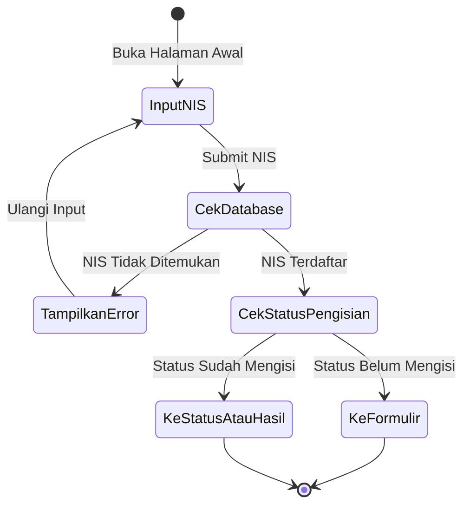

#### 2. Activity Diagram UC-02: Pengisian Instrumen Minat dan Bakat
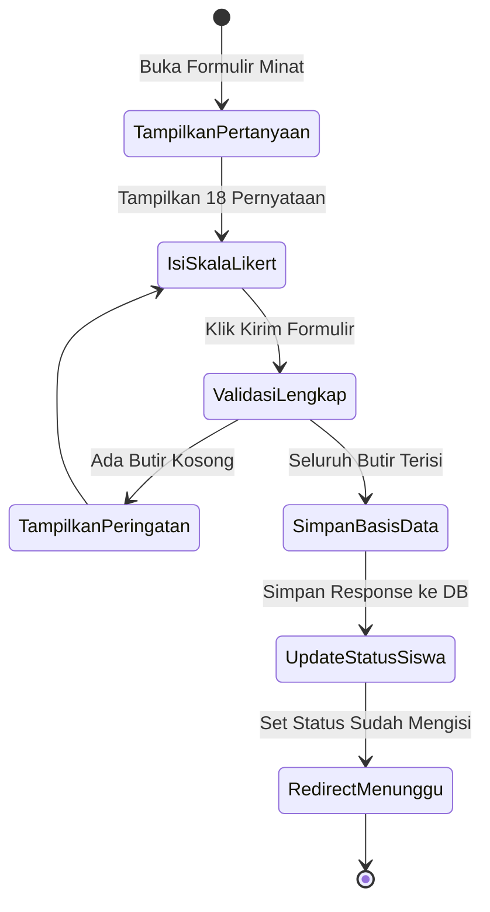

#### 3. Activity Diagram UC-03: Melihat Hasil Rekomendasi Top-5 Jurusan
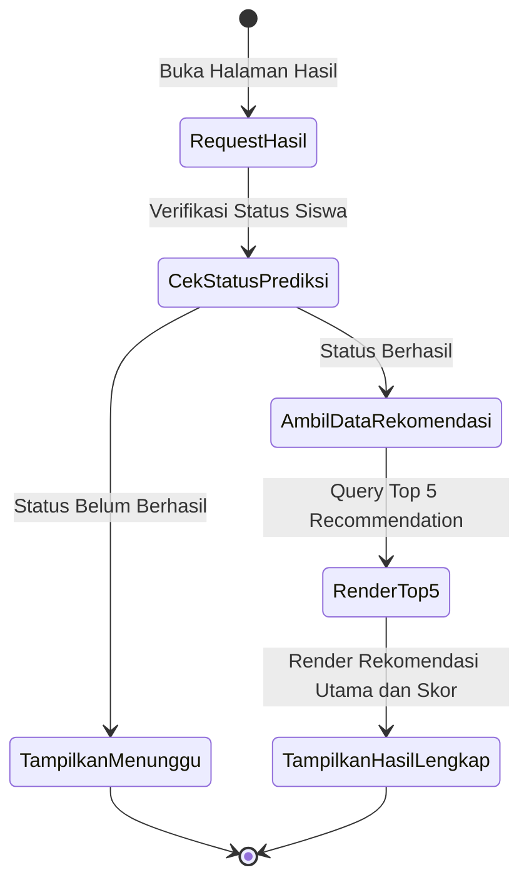

#### 4. Activity Diagram UC-04: Login dan Autentikasi Admin
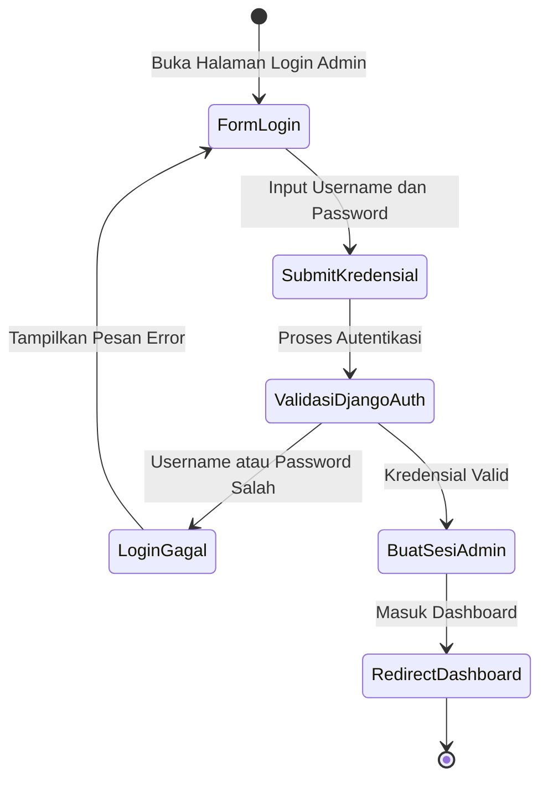

#### 5. Activity Diagram UC-05: Pengelolaan Data Siswa dan Nilai Rapor
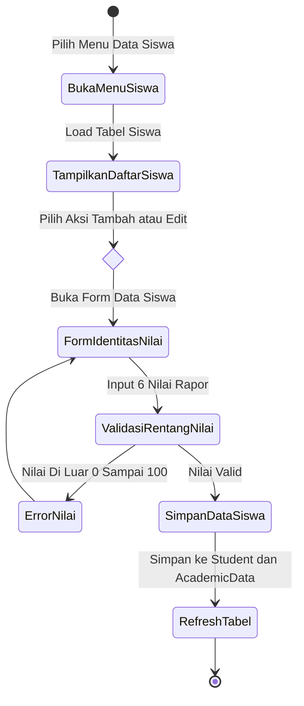

#### 6. Activity Diagram UC-06: Pengelolaan Data Latih dan Pelatihan Model RF
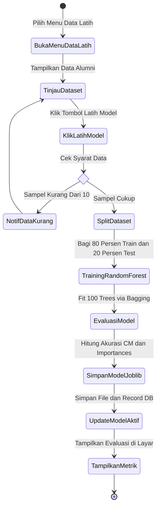

#### 7. Activity Diagram UC-07: Eksekusi Prediksi Jurusan dan Detail Perhitungan
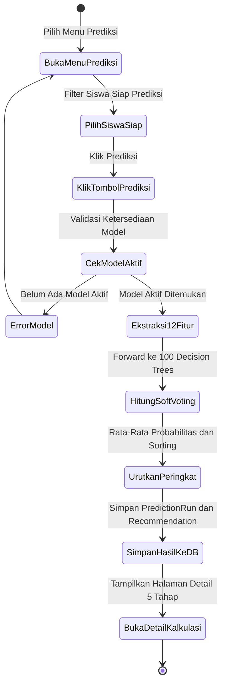

---

### 3.4.3 Sequence Diagram (7 Diagram Sesuai Use Case)

#### 1. Sequence Diagram UC-01: Verifikasi NIS dan Akses Siswa
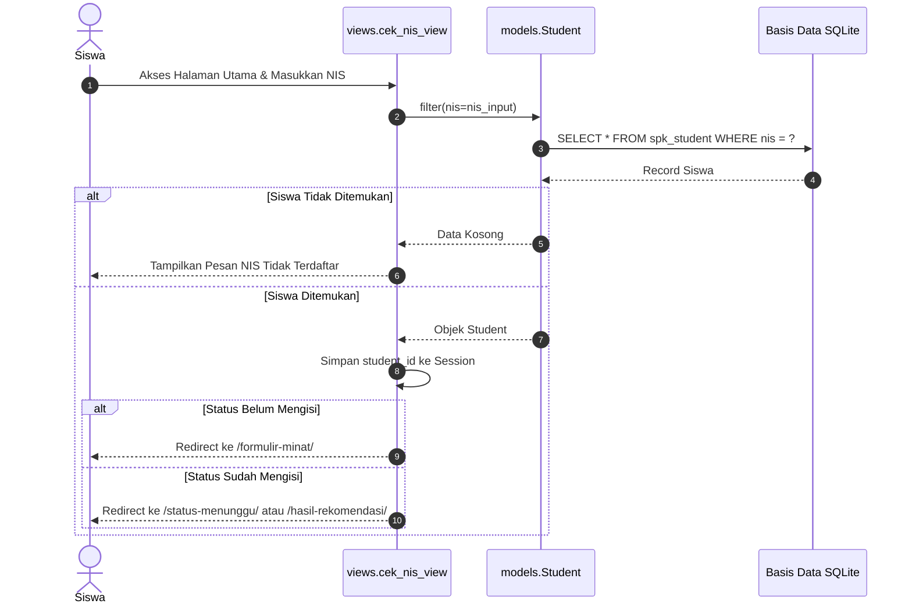

#### 2. Sequence Diagram UC-02: Pengisian Instrumen Minat dan Bakat
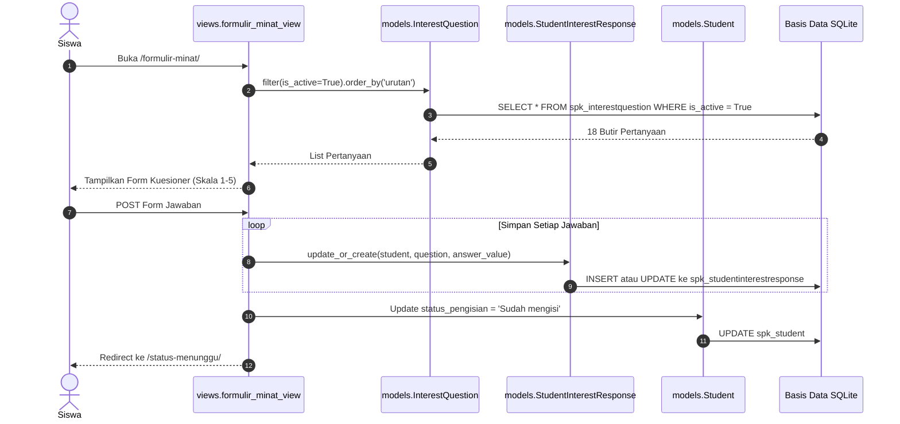

#### 3. Sequence Diagram UC-03: Melihat Hasil Rekomendasi Top-5 Jurusan
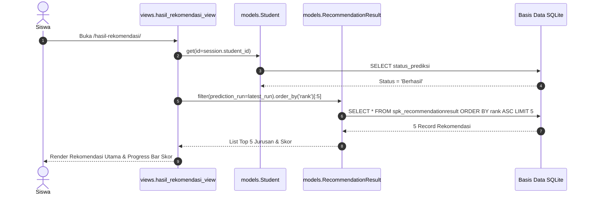

#### 4. Sequence Diagram UC-04: Login dan Autentikasi Admin
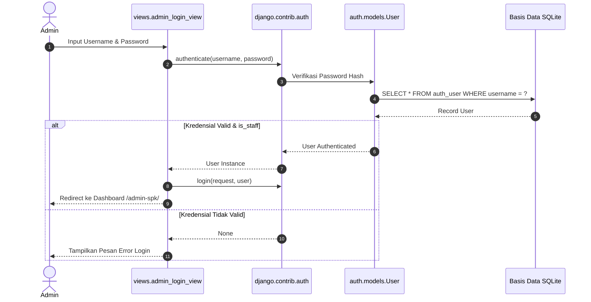

#### 5. Sequence Diagram UC-05: Pengelolaan Data Siswa dan Nilai Rapor
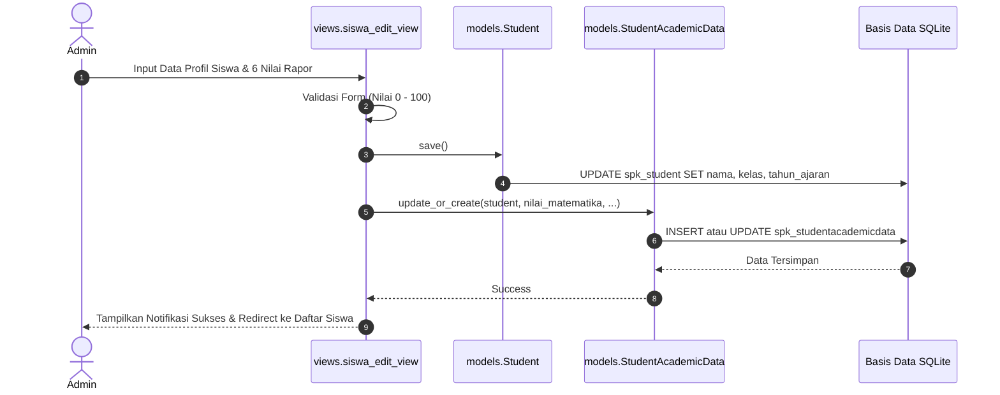

#### 6. Sequence Diagram UC-06: Pengelolaan Data Latih dan Pelatihan Model RF
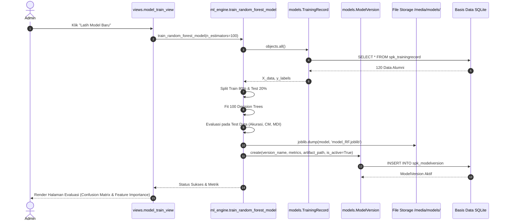

#### 7. Sequence Diagram UC-07: Eksekusi Prediksi Jurusan dan Detail Perhitungan
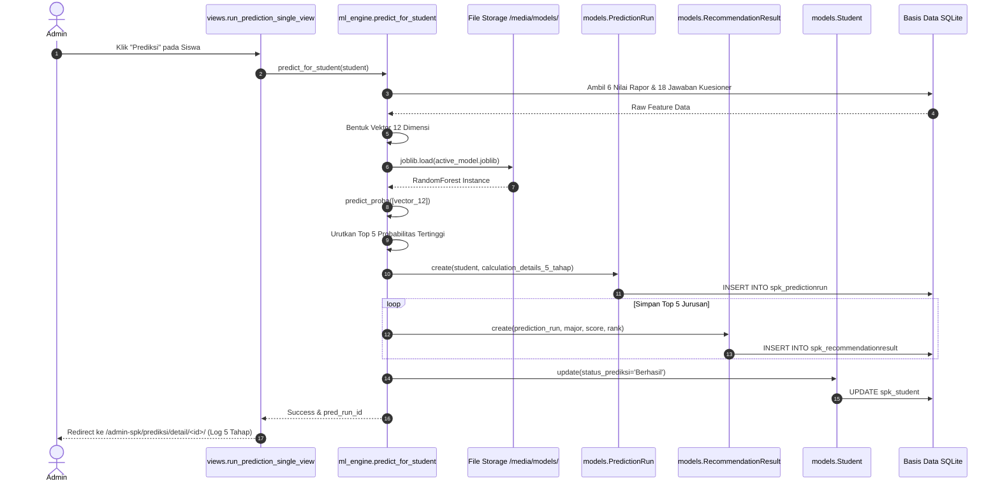

---

### 3.4.4 Class Diagram

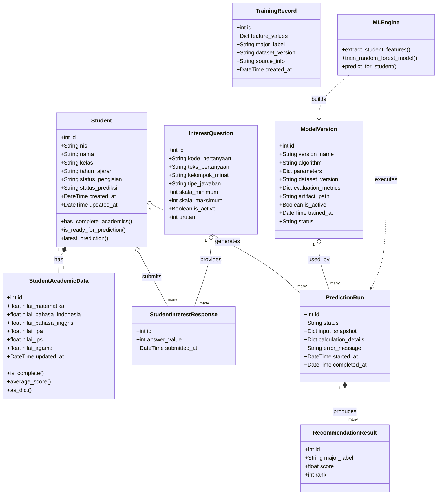

---

## 3.5 Perancangan User Interface (Antarmuka Pengguna)

Sistem SISPEJUR membedakan perancangan antarmuka ke dalam dua portal pengguna yang terpisah secara fisik dan fungsional: **Portal Siswa** dan **Portal Admin**.

### 3.5.1 Rancangan Halaman Verifikasi NIS Siswa (`/`)
- **Tujuan:** Gerbang masuk siswa untuk mengidentifikasi data dirinya tanpa memerlukan pembuatan akun dengan password yang rumit.
- **Elemen Antarmuka:**
  - Header dengan Logo MA Plus Peradaban Insani dan judul aplikasi.
  - Form input tunggal: Field `Nomor Induk Siswa (NIS)`.
  - Tombol aksi: "Cek Data Saya".
  - Tautan navigasi: "Masuk sebagai Admin" menuju login admin.
  - Alert error: Muncul dinamis jika NIS tidak terdaftar pada basis data.

### 3.5.2 Rancangan Halaman Formulir Minat & Bakat Siswa (`/formulir-minat/`)
- **Tujuan:** Pengumpulan preferensi minat dan bakat siswa.
- **Elemen Antarmuka:**
  - Ringkasan profil siswa (Nama, NIS, Kelas).
  - Indikator progres pengisian formulir.
  - Daftar 18 butir pernyataan yang dikelompokkan ke dalam 6 rumpun minat:
    1. *Teknologi & Komputer*
    2. *Sains & Kesehatan*
    3. *Ekonomi & Bisnis*
    4. *Sosial & Hukum*
    5. *Seni & Bahasa*
    6. *Pendidikan*
  - Komponen input: Radio button skala Likert 1 (Sangat Tidak Minat) hingga 5 (Sangat Berminat).
  - Tombol aksi: "Kirim Jawaban Formulir".

### 3.5.3 Rancangan Halaman Status Menunggu Prediksi (`/status-menunggu/`)
- **Tujuan:** Memberikan umpan balik langsung setelah siswa mengirimkan respons kuesioner.
- **Elemen Antarmuka:**
  - Kartu status visual: Ilustrasi jam pasir / ikon proses.
  - Informasi status: Menampilkan teks bahwa data kuesioner telah tersimpan dan menunggu eksekusi validasi oleh Guru BK / Admin.
  - Tombol interaktif: "Muat Ulang Status" dan "Selesai / Keluar".

### 3.5.4 Rancangan Halaman Hasil Rekomendasi Siswa (`/hasil-rekomendasi/`)
- **Tujuan:** Menyajikan luaran rekomendasi 5 jurusan teratas kepada siswa.
- **Elemen Antarmuka:**
  - Hero banner rekomendasi utama: Kartu besar berwarna hijau/emas menampilkan **Rekomendasi Utama (Rank 1)** beserta skor persentase kecocokan.
  - Tabel dan progress bar daftar Top-5 Jurusan:
    - Peringkat 1 s/d 5.
    - Nama jurusan perguruan tinggi.
    - Bilah visual persentase probabilitas soft-voting model.
  - Panel informasi profil akademik dan ringkasan minat siswa.
  - Catatan disclaimer edukatif: Menyatakan bahwa rekomendasi adalah alat bantu pendukung keputusan, bukan penentu mutlak masa depan.

### 3.5.5 Rancangan Halaman Login Admin (`/admin-spk/login/`)
- **Tujuan:** Keamanan otentikasi pengelola sistem.
- **Elemen Antarmuka:**
  - Form input: `Username` dan `Password`.
  - Tombol aksi: "Masuk ke Dashboard".
  - Proteksi: CSRF Token dan pembatasan sesi (*session-based authentication*).

### 3.5.6 Rancangan Dashboard Admin (`/admin-spk/`)
- **Tujuan:** Pusat informasi statistik dan monitoring sistem.
- **Elemen Antarmuka:**
  - Sidebar navigasi dengan tepat 5 menu:
    1. **Dashboard**
    2. **Data Siswa**
    3. **Prediksi Jurusan**
    4. **Data Latih**
    5. **Logout**
  - Kartu metrik ringkasan (Stat Cards): Total Siswa, Siswa Sudah Mengisi, Siswa Menunggu Prediksi, Prediksi Berhasil, Total Data Latih, dan Status Model Aktif.
  - Widget distribusi jurusan yang paling sering direkomendasikan.
  - Tabel aktivitas prediksi terbaru.

### 3.5.7 Rancangan Halaman Data Siswa (`/admin-spk/siswa/`)
- **Tujuan:** Pengelolaan data induk siswa dan nilai rapor.
- **Elemen Antarmuka:**
  - Tombol aksi: "Tambah Siswa Baru".
  - Kotak pencarian (NIS/Nama) dan filter status pengisian/prediksi.
  - Tabel data siswa: NIS, Nama, Kelas, Status Pengisian, Status Prediksi, Rata-Rata Nilai Rapor, dan Tombol Aksi (Detail, Edit Nilai, Hapus).
  - Modal / Halaman form input nilai rapor 6 mata pelajaran.

### 3.5.8 Rancangan Halaman Data Latih & Pelatihan Model (`/admin-spk/data-latih/`)
- **Tujuan:** Pengelolaan dataset pelatihan alumni dan eksekusi model Random Forest.
- **Elemen Antarmuka:**
  - Panel kontrol pelatihan model: Tombol "Latih Model Baru", dropdown pemilihan `n_estimators`, `max_depth`, dan `test_size`.
  - Tombol "Import Data Latih (CSV)".
  - Card ringkasan model aktif: Akurasi data uji, nama versi model, dan tanggal pelatihan.
  - Visualisasi hasil evaluasi: Tabel Confusion Matrix ($10 \times 10$) dan diagram peringkat *Feature Importance* (MDI).
  - Tabel master data latih beserta tombol tambah dan hapus record.

### 3.5.9 Rancangan Halaman Prediksi Jurusan & Detail Perhitungan (`/admin-spk/prediksi/`)
- **Tujuan:** Pemilihan siswa, eksekusi prediksi, dan audit transparansi kalkulasi.
- **Elemen Antarmuka:**
  - Tabel antrean siswa yang berstatus siap diprediksi.
  - Tombol aksi per baris: "Prediksi Sekarang" dan tombol "Prediksi Massal (*Batch*)".
  - Tabel riwayat prediksi yang telah selesai.
  - **Halaman Detail Perhitungan Prediksi (`/admin-spk/prediksi/detail/<id>/`):**
    - **Tahap 1 (Data Input):** Rincian 6 nilai akademik dan 6 nilai rata-rata minat.
    - **Tahap 2 (Validasi & Preprocessing):** Validasi kelengkapan data dan vektor numerik 12 dimensi tanpa transformasi artifisial.
    - **Tahap 3 (Informasi Model):** Parameter Random Forest (jumlah pohon, versi dataset, waktu latih).
    - **Tahap 4 (Distribusi Probabilitas):** Tabel distribusi probabilitas seluruh 10 kelas jurusan dari hasil soft voting ensemble pohon.
    - **Tahap 5 (Peringkat Rekomendasi Top-5):** Tabel peringkat 1 s/d 5 lengkap dengan penanda rekomendasi utama dan persentase skor.